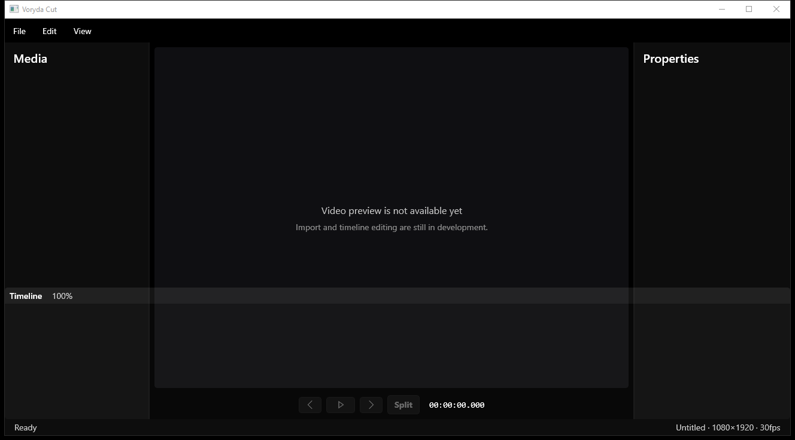

  <picture>
    <source media="(prefers-color-scheme: dark)" srcset="assets/logo-dark.png">
    <source media="(prefers-color-scheme: light)" srcset="assets/logo.png">
    
  </picture>

<h1 align="center">Voryda Cut</h1>

  <strong>A Windows video editor in early development.</strong>

  
  
  
  
  

  <a href="#overview">Overview</a> ·
  <a href="#what-is-implemented">Implemented</a> ·
  <a href="#current-limitations">Limitations</a> ·
  <a href="#build-from-source">Build</a> ·
  <a href="#privacy">Privacy</a>

## Overview

**Voryda Cut** is a native Windows video editor project built with C#, .NET 8 and WinUI 3. Its goal is to support short-form and standard video workflows, but the current application is a prototype shell rather than a usable editor.

There is **no public release build**. Import, functional timeline editing, playback preview, audio playback and final H.264/AAC export are not yet available as an end-to-end workflow.

## What is implemented

The Core project contains a non-destructive editing model and supporting data structures for:

- clips, tracks, transforms, crops, captions, text, transitions and fades;
- frame-rate and timestamp calculations, including rational frame rates;
- editing commands with undo and redo;
- versioned <code>.areacut</code> project serialization;
- social output presets and safe-area profiles;
- SRT caption parsing and export.

The WinUI 3 application has an editor-shaped window with media, preview, properties and timeline areas. These areas are currently a shell; several menu actions are disabled because their workflows are not ready.

## Current limitations

| Workflow | Current state |
| --- | --- |
| Create a new project | Basic shell behavior |
| Import media | Not implemented as a user workflow |
| Edit a timeline | Not implemented |
| Preview video or play audio | Not implemented |
| Export H.264/AAC video | Not implemented |
| Open, save and export through the editor menus | Not available in the current UI |
| Public installer or GitHub Release | Not published |

Do not rely on the current application as a production video editor. Core project-model code should not be confused with a complete, usable editing workflow.

## Screenshot

*This image shows the current prototype shell, not a released editing application.*

## Architecture

| Project | Responsibility | Maturity |
| --- | --- | --- |
| <code>AreaCut.App</code> | WinUI 3 window, menus and keyboard handling. | Shell |
| <code>AreaCut.Core</code> | Project model, commands, undo/redo, serialization and time math. | Implemented foundation |
| <code>AreaCut.Media</code> | Media Foundation access, metadata and thumbnails. | Partial or stubbed |
| <code>AreaCut.Rendering</code> | D3D11 composition and preview clock. | Partial or stubbed |
| <code>AreaCut.Audio</code> | WASAPI-facing playback, mixing and waveform groundwork. | Incomplete |
| <code>AreaCut.Export</code> | Render pipeline and export presets. | Groundwork |
| <code>AreaCut.Transcription</code> | Caption presets and SRT support. | Partial |

The <code>.areacut</code> project format stores editing data and references source media; it does not embed source video files.

## Requirements

- Windows 10 version 2004 (build 19041) or Windows 11, x64.
- .NET 8 SDK.
- Direct3D 11-capable graphics hardware and Windows Media Foundation for the native media components.
- Windows App SDK and Windows SDK build tools, restored from the project.

## Build from source

    git clone https://github.com/smouj/voryda-cut
    cd voryda-cut
    .\scripts\BUILD.ps1
    dotnet run --project src\AreaCut.App\AreaCut.App.csproj

The repository contains a Windows CI workflow that builds the solution and runs the Core tests. See [the build guide](docs/development/building.md) and [the documentation index](docs/README.md) for the current development setup.

## Privacy

The current app has no account system, analytics or cloud storage workflow. Project files and media remain on the user's machine; <code>.areacut</code> projects store references to source files.

See [the privacy notes](docs/user/privacy.md) for details.

## License

Voryda Cut is distributed under the [MIT License](LICENSE). Third-party notices are listed in [THIRD_PARTY.md](THIRD_PARTY.md).

---

  <strong>Voryda</strong> 
  Focused Windows utilities.

  <a href="https://github.com/smouj/voryda-snap">Snap</a> ·
  <a href="https://github.com/smouj/voryda-rec">Rec</a> ·
  <a href="https://github.com/smouj/voryda-down">Down</a> ·
  <a href="https://github.com/smouj/voryda-cut">Cut</a>

